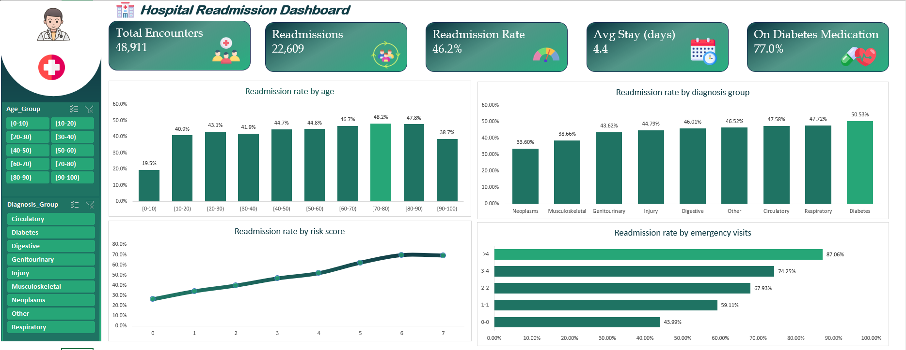

# Hospital Readmission Analysis (Excel)

End-to-end Excel analysis of 48,911 hospital encounters to find what drives 30-day readmissions, with a slicer-driven dashboard and a documented report.

## Business problem
A hospital saw readmissions spike, raising costs and raising quality-of-care questions. This project finds the patterns and risk factors linked to readmission within 30 days and recommends how to reduce them.

## Key findings
- Overall 30-day readmission rate: **46.2%** (22,609 of 48,911 encounters)
- **Prior emergency visits** are the clearest warning sign: readmission rises from 44.0% (none) to 87.1% (five or more)
- **Comorbidity** matters: readmission rises from 22.6% (1 diagnosis) to 50.7% (9 diagnoses)
- **Diabetes** drives the problem: 47.9% vs 40.5% readmitted, about 80% of all readmissions
- **Medication changes** go with higher risk: 48.7% vs 44.1% (z = 10.11, p < 0.001)
- A simple **risk score** separates patients from 26.2% (score 0) to 69.5% (score 6) readmitted

## What I did
- Cleaned the data: removed 3 unusable columns and 17,676 exact duplicate rows, and handled missing values (weight was 96.8% missing)
- Built one pivot table per question and answered all 25 questions from the brief, documenting 6 that the data cannot fully answer
- Used correlation, regression, z-tests and t-tests to check whether differences were real
- Built a rule-based risk score and patient segments, and designed a tiered follow-up program with scenario estimates
- Built an interactive dashboard: 5 KPI cards, 4 charts and slicers

## Files
- `Hospital Administration Analysis_Dashboard.xlsx`: the full workbook (cleaned data, one sheet per question, dashboard)
- `Hospital_Readmission_Analysis_Report.pdf` / `.docx`: the full report with all questions, methods, results and recommendations
- `dashboard.png`: dashboard preview

## Tools
Microsoft Excel: Tables, pivot tables and charts, slicers, formulas (XLOOKUP, COUNTIFS, AVERAGEIFS, CORREL, T.TEST)

## Limitations
Findings show association, not cause. Medication names are anonymised, and the data has no dates, cost, discharge or satisfaction fields. See the report for details.

## Data source
Dataset provided with the DACS08 hospital administration case study. The data file is not redistributed here.

**Author:** Md Ziaul Haque
